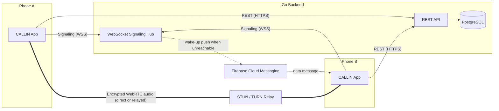
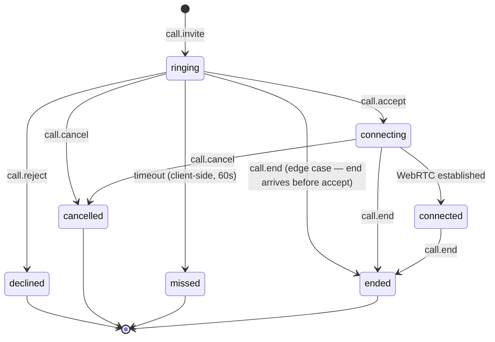
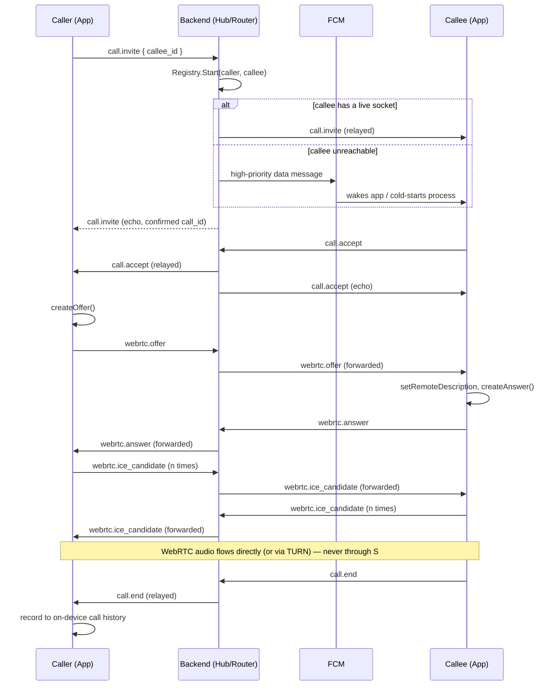

# CALLIN Architecture

This document describes how CALLIN is built end to end: the Go backend, the Android client,
the real-time signaling layer that connects them, and the design decisions behind each piece.
It is the reference to read before making a structural change to either codebase.

## Table of Contents

1. [`System Overview`](#1-system-overview)
2. [`Design Principles`](#2-design-principles)
3. [`Backend Architecture`](#3-backend-architecture)
4. [`Android Client Architecture`](#4-android-client-architecture)
5. [`End-to-End Call Sequence`](#5-end-to-end-call-sequence)
6. [`Data Model`](#6-data-model)
7. [`Security Model`](#7-security-model)
8. [`Reliability & Failure Handling`](#8-reliability--failure-handling)
9. [`Known Constraints & Future Direction`](#9-known-constraints--future-direction)

---

## 1. System Overview

CALLIN has three moving parts: an Android client, a Go backend, and a WebRTC media path that,
critically, does **not** run through the backend.



The backend's job is **coordination, not media**. It authenticates users, tracks who is
connected, relays small JSON control messages, and wakes a device with a push notification
when it can't be reached directly. Once a call is accepted, the actual voice stream travels
peer-to-peer (or through a TURN relay when NAT traversal fails) and the backend has no
visibility into it at all.

## 2. Design Principles

| Principle | How it shows up in the code |
|---|---|
| **The backend never touches audio.** | `internal/signaling` only ever forwards JSON envelopes; there is no media server. |
| **Minimal server-side state.** | Call history is *not* persisted server-side (see [§6](#6-data-model)); only account, device-token, and connection-graph data live in Postgres. |
| **Privacy by construction.** | `migrations/0003_connections.sql` explicitly notes the schema "excludes anything richer: no call history, no record of who called whom" — that constraint was a deliberate product decision, not an oversight. |
| **Single source of truth for UI state.** | On Android, `CallRepository.state` (a `StateFlow<CallUiState>`) is the *only* thing every surface (notification, in-call banner, Call screen, foreground service) reads from. Nothing derives call state independently. |
| **Degrade, don't crash.** | Every cross-cutting Android component (FCM service, broadcast receiver, foreground service) wraps its entry points in `try/catch` — a failure in one subsystem must never take down the process a call depends on. |
| **Reachability over elegance.** | The signaling layer actively distinguishes "this socket looks open" from "this socket has proven itself alive in the last N seconds" (see [§3.5](#35-real-time-signaling-hub--client--router)) because the two are not the same thing on mobile networks. |

## 3. Backend Architecture

Module: `Callin-Go`, Go 1.26, standard-library `net/http` with Go 1.22+ method-pattern routing
(no web framework).

### 3.1 Process Wiring

`cmd/server/main.go` is a single composition root: it loads configuration, opens the database
pool, constructs every repository/service/handler, wires the HTTP mux, and starts the server
with graceful shutdown on `SIGINT`/`SIGTERM`. There is no dependency-injection framework —
everything is built once at startup and passed down by constructor.

### 3.2 Package Responsibilities

| Package | Responsibility |
|---|---|
| `internal/config` | Loads and validates every environment variable the process needs (see [`docs/backend-setup.md`](backend-setup.md)). Fails fast at boot if `DATABASE_URL` or `JWT_SECRET` is missing/invalid. |
| `internal/db` | Owns the `pgxpool.Pool` — connection limits, lifetime, and a startup ping so a bad `DATABASE_URL` fails immediately rather than on the first request. |
| `internal/auth` | Account registration/login (bcrypt), JWT issuance/verification (`golang-jwt/v5`, HMAC), and Google ID-token verification via OIDC discovery. |
| `internal/user` | User profile, the two-step "complete your profile" flow for Google accounts, username availability, avatar URL persistence, FCM device-token bookkeeping. |
| `internal/connection` | The "add contact" graph: pending/accepted/rejected connection requests. This is the *only* place a relationship between two accounts is recorded. |
| `internal/call` | **In-memory only.** A concurrency-safe registry of calls that are currently ringing or connected, plus the state machine that governs legal transitions. Nothing here touches Postgres. |
| `internal/signaling` | The real-time layer: `Hub` (who's connected), `Client` (one WebSocket connection), `Router` (validates and dispatches every inbound message). See [§3.5](#35-real-time-signaling-hub--client--router). |
| `internal/push` | Sends high-priority FCM data messages to wake a callee's device when the signaling socket can't reach them, and prunes tokens FCM reports as permanently dead. |
| `internal/storage` | A thin REST client for Supabase Storage, used only for profile-photo uploads. |
| `internal/middleware` | JWT bearer-token enforcement, structured request logging (WebSocket-upgrade-safe — see note below), and a per-IP token-bucket rate limiter. |
| `pkg/logger` | One `slog` logger for the whole process: human-readable text in development, structured JSON in production. |
| `pkg/keepalive` | Self-pings `/healthz` every 10 minutes so a free-tier Render instance is never idled out between calls. |

### 3.3 Request Pipeline

```
Request → Logging middleware → Rate limiter (per IP) → ServeMux → [Auth middleware] → Handler
```

The logging middleware wraps `http.ResponseWriter` to capture the status code for the access
log, but it also forwards `Hijack()` and `Flush()` to the underlying writer. This is not
incidental: `gorilla/websocket`'s upgrader requires the `ResponseWriter` it receives to
implement `http.Hijacker` so it can take over the raw TCP connection, and Go's interface
satisfaction is structural — simply embedding `http.ResponseWriter` does **not** pull in
`Hijack()`. Without this forwarding, every `/ws` upgrade fails, which silently breaks every
downstream call feature. It is called out here because it is the easiest thing to regress
if the logging middleware is ever "simplified."

### 3.4 Authentication Subsystem

Two independent credential paths feed the same token issuance code:

- **Classic (username + password):** bcrypt-hashed, kept for completeness/testing; the shipped
  Android app does not expose a registration form for it.
- **Google Sign-In:** the Android app obtains a Google ID token via Credential Manager, signed
  for a **Web** OAuth client (not an Android-specific one) — this is a Credential Manager
  requirement, which is why the backend's `GOOGLE_WEB_CLIENT_ID` must match the Android app's
  web client ID exactly. The backend verifies signature, issuer, audience, and expiry via
  Google's OIDC discovery document, and rejects unverified-email tokens outright.

A Google account with no prior CALLIN record is created with `profile_completed = false` and
no username; the client is routed to a one-time "complete your profile" screen. Once
submitted, `profile_completed` flips to `true` and the backend refuses to run that step again
for the same account — username and name are permanent by server-side contract, not just UI
convention.

Access and refresh tokens are both minted only at `Register`/`Login`/`GoogleSignIn`
(`issueTokens`). `Refresh` mints a new **access** token only — the refresh token's expiry is
fixed at the moment it was first issued and is never extended by use, so a session lasts
exactly `JWT_REFRESH_TTL_HOURS` from first sign-in, not from last activity.

### 3.5 Real-Time Signaling: Hub / Client / Router

| Component | Role |
|---|---|
| `Hub` | A `map[userID]set[*Client]` — a user may be signed in on several devices at once. Delivers a message to every open connection for a user. |
| `Client` | One WebSocket connection: a read pump, a write pump, and a ping/pong liveness tracker. |
| `Router` | Validates every inbound envelope's `type` and dispatches it; never trusts client-supplied `from`/`timestamp` (both are overwritten server-side). |

**Liveness, precisely:** a client pings every 28s (`pingPeriod`, 80% of `pongWait`) and the
server resets its read deadline on every pong it receives. A connection is considered
`IsAlive()` only if a pong landed within the last 35s (`aliveWindow == pongWait`). This matters
because `Hub.SendToUser` takes a `requireAlive` flag:

- **`call.invite` → `requireAlive = true`.** A TCP socket that the OS hasn't yet noticed is
  dead (common right after a phone wakes from deep sleep or a screen lock) looks "connected"
  to the hub for up to a minute. If a brand-new incoming call were delivered to such a zombie
  connection, the hub would believe it succeeded and never fall back to a push notification —
  the call would simply vanish. Requiring recent proof of life is what decides whether FCM
  needs to wake the device instead.
- **Every other message type → `requireAlive = false`.** `call.end`/`reject`/`cancel`, WebRTC
  offer/answer/ICE candidates, and disconnect notifications are all attempted on *every*
  registered connection regardless of pong freshness. Writing to a genuinely dead connection
  costs nothing — the channel write queues harmlessly or the socket is already being torn down
  elsewhere — so for anything except the very first ring, unconditional delivery is strictly
  safer than filtering it out. (An earlier revision filtered these too; the symptom was calls
  that the ending party saw end locally while the peer's screen stayed stuck on "Active"
  forever.)

**Call state** is owned by `internal/call.Registry`, an in-memory map guarded by a mutex —
intentionally single-instance (see [§9](#9-known-constraints--future-direction)). Valid
transitions:



The `ringing → ended` edge exists specifically so an `end` arriving before a call was ever
accepted still releases both parties from the registry — without it, both users were reported
"busy" indefinitely until the process restarted.

A user who is fully disconnected (no remaining open sockets) has any call they were in force-
ended by the router, with the peer notified — a dropped app can never leave the other side
ringing forever.

### 3.6 Push Notification Subsystem

`internal/push` sends a high-priority FCM **data** message (never a display notification —
the Android client builds its own full-screen incoming-call UI) carrying `call_id`,
`caller_id`, and enough caller profile data (`username`, `display_name`, `avatar_url`) for the
callee's device to render a ringing screen without an extra network round-trip. If FCM reports
a token as permanently dead (`NOT_FOUND` / `NotRegistered` / `UNREGISTERED`), that specific
token is deleted from `devices` immediately — ordinary FCM housekeeping, and what stops one
stale install from silently absorbing every future call attempt to that user while a valid
token sits unused right next to it.

### 3.7 Storage Subsystem

Profile photos are the only user-generated file CALLIN stores. `internal/storage` is a ~40-line
REST client against Supabase Storage's object API; uploads use `x-upsert: true` so a new photo
overwrites the previous one at a stable, predictable path (`avatars/<user_id>.<ext>`). The
bucket must be public for the resulting URL to be directly usable by `Coil` on the client.

## 4. Android Client Architecture

Module: `Callin-Android`, Kotlin, Jetpack Compose, `compileSdk 37` / `minSdk 26`.

### 4.1 Composition Root

There is no Hilt/Dagger. `AppContainer` (constructed once in `CallinApplication.onCreate`) is a
plain class that builds every dependency by hand, in dependency order: `TokenStore` →
`RetrofitProvider` → the `*Api` interfaces → the `*Repository` classes → `SignalingClient` →
`CallRepository`. Every screen receives `AppContainer` and reads what it needs from it. This is
a deliberate choice for a codebase this size: fewer moving parts, and the full dependency graph
is readable top-to-bottom in one file.

### 4.2 State Ownership

| Store | Backing | Owns |
|---|---|---|
| `TokenStore` | DataStore (Preferences) | Access/refresh tokens, `profile_completed`, one-time permission flags |
| `UserRepository` | In-memory `StateFlow` + Retrofit | The signed-in user's own profile (`me`) |
| `ConnectionRepository` | In-memory `StateFlow` + Retrofit + on-device log | Accepted contacts, pending incoming requests, a 30-day notification history |
| `RecentCallsStore` | DataStore (JSON) | Call history — **entirely on-device**, capped at 200 entries, self-pruned past 30 days |
| `RingtoneStore` | DataStore (Preferences) | Which bundled ringtone asset the user picked |
| `CallRepository` | In-memory `StateFlow<CallUiState>` | The single authoritative state of whatever call is currently ringing/connecting/active |

A screen never computes "am I on a call" independently — it collects `CallRepository.state`
(or one of the stores above) and renders whatever it sees. This is what lets the in-call
banner, the Call screen, the system notification, and the foreground service all stay in sync
without any of them polling or messaging each other directly.

### 4.3 Navigation

`CallinNavHost` resolves a start destination purely from local, synchronous state
(`TokenStore`) — it never blocks on a network call, so the destination (Login /
CompleteProfile / Home / directly-into-Call) resolves instantly regardless of connectivity. A
separate `LaunchedEffect` collects `CallRepository.state` independently of the navigation
graph's readiness and either pushes the full-screen `Call` route or shows a slim
`InCallBanner` pinned under the status bar — so a call that arrives while the user is three
screens deep in Contacts is never missed, and never interrupts what they were doing more than
necessary.

### 4.4 Call Lifecycle (`CallRepository`)

This is the most load-bearing class in the Android app. It:

1. Owns `CallUiState` (`Idle | Outgoing | Incoming | Active | Ended`) and is the only writer to it.
2. Drives every side effect of a state change through one `setState()` choke point: the system
   notification (`CallNotifier`), the audio route (`AudioManager` mode + speakerphone), ringback/
   ringtone playback with proper audio-focus requests, a proximity wake lock while `Active`, the
   60-second ring timeout, and starting/stopping `CallForegroundService`.
3. Owns one `WebRtcClient` per call attempt, created lazily and released the instant the call
   ends — never reused across calls.
4. Watches the underlying `PeerConnection.IceConnectionState`: `FAILED` ends the call locally
   immediately; `DISCONNECTED` is given an 8-second grace period (ICE can recover from a brief
   network blip on its own) before being treated as a real failure. Earlier revisions ignored
   ICE state entirely, which meant a call that never actually established audio could still show
   as "Active" with a running timer — connected in the UI, silent in reality.
5. Always auto-returns to `Idle` a fixed 1.2s after reaching `Ended`, from *inside the
   repository itself*, not from a `LaunchedEffect` in the Call screen composable. If the UI
   layer alone owned that timer and the screen was ever torn down before it fired, the state
   would get stuck on `Ended` forever, and since `startCall()` refuses to do anything unless
   state is `Idle`, every future call attempt from that device would silently do nothing.

### 4.5 Background & Lock-Screen Delivery

An incoming call must ring even if the app is fully backgrounded, the screen is locked, or the
process was just cold-started by FCM. Three cooperating pieces make that possible:

- **`CallForegroundService`** — started the instant any non-`Idle` state begins, keeps the
  process (and therefore the WebSocket/WebRTC session) alive regardless of Recents-swipe or
  screen state. Declared with `foregroundServiceType="microphone"` specifically — `phoneCall`
  requires Android Telecom integration (a self-managed `ConnectionService`), which this app does
  not implement, and attempting it crashed the process immediately on an earlier build.
- **`CallNotifier`** — the one system notification CALLIN ever shows for a call. Incoming calls
  get a `setFullScreenIntent` (wakes the screen, draws over the lock screen) with Accept/Decline
  actions; connected calls get an ongoing notification with a live chronometer sourced from the
  same `startedAtMillis` both devices share, so caller and callee display identical elapsed time.
- **`CallActionReceiver`** — handles the notification's action buttons via `goAsync()` with a
  defensive `try/catch`, since a cold-process broadcast receiver is the most fragile moment in
  the app: `AppContainer` may still be mid-construction when the button is tapped.

### 4.6 Media Layer

`WebRtcClient` wraps exactly one audio-only `PeerConnection` for the lifetime of a single call
(`UNIFIED_PLAN` SDP semantics, hardware AEC/NS via `JavaAudioDeviceModule`). `IceServers`
supplies a public STUN server plus a TURN relay as fallback for NAT configurations that can't
establish a direct path (notably carrier-grade NAT, common across mobile data). ICE candidates
generated before the remote SDP answer has arrived are buffered (`pendingLocalCandidates`) and
flushed once signaling confirms the peer is ready — candidates are never dropped due to
ordering.

### 4.7 QR-Based Contact Exchange

Adding a contact is a camera-only flow (`ScanQrScreen`, CameraX + ML Kit on-device barcode
decoding) — there is deliberately no gallery picker, so a connection can only be formed by
pointing a live camera at another device's code, never by scanning a screenshot. A CALLIN code
encodes `callin://user/<username>`; scanning it calls `POST /connections/request`, which the
backend auto-accepts instantly if the other party already sent a request the other way.

## 5. End-to-End Call Sequence



Full message shapes and every state transition are documented in [`docs/signaling-protocol.md`](signaling-protocol.md).

## 6. Data Model

| Table | Purpose | Written by |
|---|---|---|
| `users` | Accounts — classic and Google, merged into one row per person once linked | `internal/auth`, `internal/user` |
| `devices` | One row per installed app instance registered for push | `internal/user` (register), `internal/push` (prune on dead token) |
| `connections` | The accepted-contact graph | `internal/connection` |
| `calls` *(schema present, unused)* | Historical per-call record (caller/callee/status/timestamps) | — |
| `call_stats` *(schema present, unused)* | Reserved for a fully anonymous "calls connected today" counter with no reference to who was on it | — |

`calls` and `call_stats` exist in the migration history but nothing in the current backend
writes to either. This is intentional: an earlier revision persisted full call history
server-side; it was deliberately removed in favor of the Android client's on-device
`RecentCallsStore`, matching the product's stated privacy position ("no call history, no record
of who called whom" — see `migrations/0003_connections.sql`). The tables are left in place
rather than dropped so the migration history stays linear and reversible.

## 7. Security Model

- **Transport:** TLS end-to-end for both the REST API and the WebSocket (`wss://`); call audio
  is additionally encrypted in transit by WebRTC's mandatory DTLS-SRTP regardless of transport.
- **Tokens:** short-lived HMAC-signed access tokens (default 15 min) plus a long-lived refresh
  token (default 30 days) whose clock starts at issuance and never resets.
- **WebSocket auth:** the access token travels as a query parameter (`/ws?token=...`), not a
  header — WebSocket clients cannot always set custom headers during the handshake. This is a
  known, accepted trade-off for this transport; see [`docs/signaling-protocol.md`](signaling-protocol.md).
- **Abuse protection:** a per-IP token-bucket rate limiter sits in front of every HTTP route,
  configurable via `RATE_LIMIT_RPS`/`RATE_LIMIT_BURST`.
- **IP exposure:** direct peer-to-peer WebRTC inherently exposes each participant's IP address
  to the other during connectivity establishment — this is disclosed to users in the in-app
  Privacy Policy, not hidden.
- **No recording, no server-side storage of audio or call content, ever.**

## 8. Reliability & Failure Handling

| Failure mode | Mitigation |
|---|---|
| Backend restarts mid-call | In-memory registry is lost; affected clients' sockets drop, triggering their own reconnect + the router's disconnect-based call termination on the next connection it does see. |
| Client loses network mid-call | `SignalingClient` reconnects with exponential backoff (1s → 2s → 4s → 8s → capped at 15s) and additionally listens for `ConnectivityManager` "network available" callbacks to retry immediately rather than wait out the backoff. |
| A slow/stuck client back-pressuring the hub | `Hub.SendToUser` drops a connection outright (rather than blocking) if its send buffer (32 messages) is full. |
| App process killed while a call is active | `CallForegroundService` (`stopWithTask="false"`) and the Android Telecom-adjacent notification keep the process alive through a Recents swipe; a genuine OS kill is recovered via FCM wake-up + `MainActivity.onResume`'s unconditional reconnect + device re-registration. |

## 9. Known Constraints & Future Direction

- **Single backend instance.** Both `IPRateLimiter` and `call.Registry` are in-process maps —
  correct and simple at current scale, but they do not coordinate across multiple backend
  replicas. The documented path forward, if CALLIN ever needs horizontal scaling, is moving
  both to Redis.
- **Voice only.** No video, no SIP/PSTN bridging — by design, not as a stopgap.
- **No automated backend test suite yet.** See [`docs/testing-guide.md`](testing-guide.md) for the current 
  state of test coverage and where to start.
