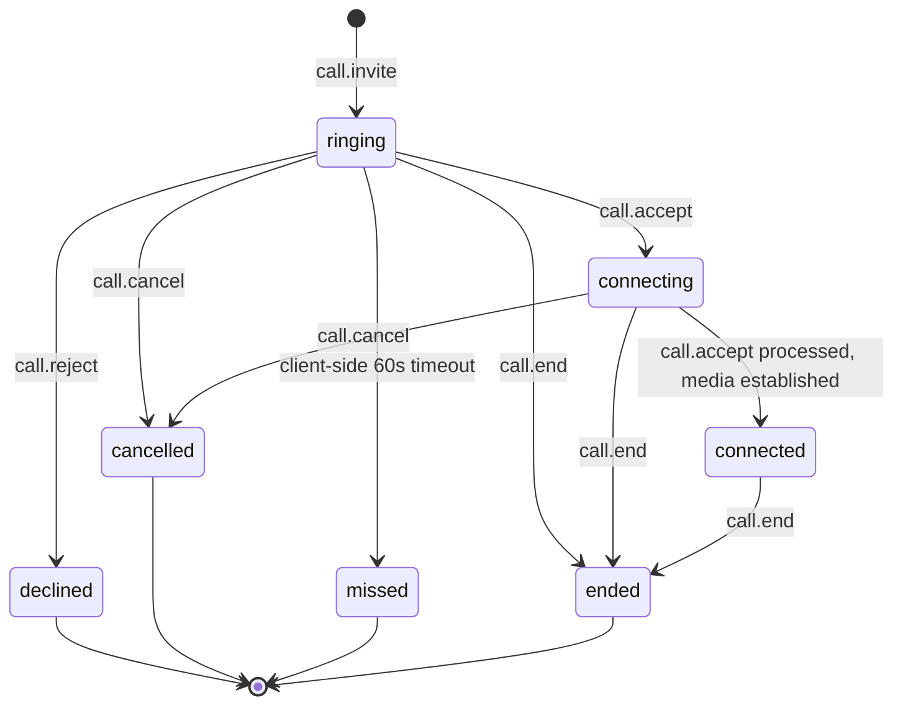
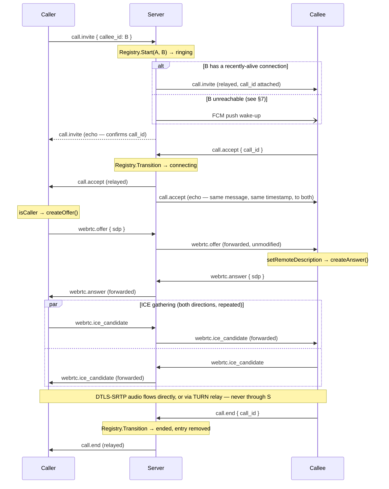

# Signaling Protocol

The authoritative specification of the WebSocket protocol that carries call control
(invite/accept/reject/cancel/end) and WebRTC negotiation (SDP offer/answer, ICE candidates)
between two CALLIN clients, brokered through the Go backend. If you are implementing a new
client, or changing message shapes on either side, this is the contract both sides must agree
on.

## Table of Contents

1. [`Connecting`](#1-connecting)
2. [`Message Envelope`](#2-message-envelope)
3. [`Message Types`](#3-message-types)
4. [`Payload Shapes`](#4-payload-shapes)
5. [`Call State Machine`](#5-call-state-machine)
6. [`Full Call Sequence`](#6-full-call-sequence)
7. [`Push Notification Fallback`](#7-push-notification-fallback)
8. [`Liveness & Keepalive`](#8-liveness--keepalive)
9. [`Client Reconnection Strategy`](#9-client-reconnection-strategy)
10. [`Disconnect Handling`](#10-disconnect-handling)
11. [`Error Handling`](#11-error-handling)
12. [`Security Notes`](#12-security-notes)

---

## 1. Connecting

```
GET /ws?token=<JWT access token>
```

The access token is passed as a **query parameter**, not an `Authorization` header — see
[`§12`](#12-security-notes) for why. The server verifies the token before completing the
WebSocket upgrade; an invalid or expired token is rejected with `401` and the upgrade never
happens. A single user may hold several simultaneous connections (one per signed-in device);
the server fans out messages to all of them.

## 2. Message Envelope

Every frame, in both directions, is a single JSON object with this shape:

```json
{
  "type": "call.invite",
  "call_id": "6e1e6f0a-...",
  "from": "user-id-of-sender",
  "to": "user-id-of-recipient",
  "payload": { "...": "type-specific, see §4" },
  "timestamp": 1699999999999
}
```

| Field | Type | Notes |
|---|---|---|
| `type` | string | One of the closed set in [`§3`](#3-message-types). Unknown values get an `error` frame back, never a silent drop. |
| `call_id` | string, optional | Omitted for messages that aren't scoped to a specific call (`webrtc.*`, `ping`/`pong`). |
| `from` | string | **Always overwritten by the server** from the authenticated connection — a client cannot spoof this. |
| `to` | string, optional | The intended recipient's user ID. Required for `webrtc.*` messages; derived server-side from the call registry for call-control messages. |
| `payload` | object, optional | Type-specific body, kept as raw JSON on the wire so new types never require changing this envelope. |
| `timestamp` | integer (Unix ms) | **Always overwritten by the server** on relay — client-supplied timestamps are never trusted for anything the protocol relies on. |

Maximum frame size is **32 KB** — signaling payloads are small by nature; this is an abuse
guard, not a practical limit.

## 3. Message Types

| Type | Direction | Purpose |
|---|---|---|
| `call.invite` | Client → Server → Client | Start a call. |
| `call.accept` | Client → Server → Client | Callee accepted; moves the call to `connecting`. |
| `call.reject` | Client → Server → Client | Callee declined. Terminal. |
| `call.cancel` | Client → Server → Client | Caller gave up before the callee responded. Terminal. |
| `call.end` | Client → Server → Client | Either party ends an in-progress or connected call. Terminal. |
| `webrtc.offer` | Client → Server → Client | SDP offer. |
| `webrtc.answer` | Client → Server → Client | SDP answer. |
| `webrtc.ice_candidate` | Client → Server → Client | One ICE candidate. |
| `ping` | Client → Server | Application-level liveness probe (independent of the WebSocket protocol-level ping/pong described in §8). |
| `pong` | Server → Client | Reply to `ping`. |
| `error` | Server → Client | Malformed input or an illegal state transition. Never sent client → server. |

## 4. Payload Shapes

**`call.invite`**
```json
{ "callee_id": "user-id-to-call" }
```

**`webrtc.offer` / `webrtc.answer`**
```json
{ "sdp": "v=0\r\no=- ...", "type": "offer" }
```
`type` is `"offer"` or `"answer"` and must match the envelope's `type` field
(`webrtc.offer`/`webrtc.answer` respectively).

**`webrtc.ice_candidate`**
```json
{ "candidate": "candidate:...", "sdp_mid": "0", "sdp_mline_index": 0 }
```

**`error`**
```json
{ "code": "bad_request", "message": "call.invite requires a callee_id" }
```

`call.accept`, `call.reject`, `call.cancel`, and `call.end` carry no payload beyond the
envelope itself — `call_id` and the server-resolved `to` are sufficient.

## 5. Call State Machine

Call state is held entirely in-memory on the backend (`internal/call.Registry`) — see [`docs/architecture.md`](/architecture.md) [`§3.5`](/architecture.md#35-backend-architecture) for the implementation. Only the transitions below are legal; any
other requested transition returns an `invalid_state` error and has no effect.



`ringing → ended` is a deliberate addition beyond the "obvious" transitions: it handles a
`call.end` arriving before the callee ever accepted (e.g. the caller hangs up while it's still
ringing, or a race between `call.cancel` and `call.end`). Without this edge, such a message was
rejected as an invalid transition, the registry entry never cleared, and **both** parties were
reported "busy" on every subsequent call attempt until the process restarted.

Reaching any terminal state (`declined`, `cancelled`, `missed`, `ended`) removes the call from
the active registry immediately — there is no persisted record of it server-side (see [`docs/architecture.md`](/architecture.md) [`§6`](/architecture.md#6-data-model)).

## 6. Full Call Sequence



Note that `call.accept` is relayed to **both** parties (the peer *and* an echo back to the
sender) carrying the same server-assigned `timestamp`. Both clients use that single value as
`startedAtMillis` — this is what lets caller and callee display an identical, non-drifting
elapsed-call timer, since both compute `now - startedAtMillis` from the same number rather than
each starting their own local stopwatch.

## 7. Push Notification Fallback

`call.invite` is the **only** message type delivered with `requireAlive = true` — it is only
considered "delivered via WebSocket" if the callee has a connection that has proven itself
alive within the last 35 seconds (see [`§8`](#8-liveness--keepalive)). If no such connection
exists, the server immediately sends a high-priority FCM data message instead
(`type: incoming_call`, carrying `call_id`, `caller_id`, and enough caller profile data to
render a ringing screen without another round-trip).

Every other message type — `call.accept/reject/cancel/end`, and all `webrtc.*` forwarding — is
attempted on every registered connection regardless of liveness, because by the time those
messages exist a call is already underway and a failed delivery attempt costs nothing extra; it
either reaches a genuinely live socket or it doesn't, with no silent-success failure mode
either way.

## 8. Liveness & Keepalive

| Parameter | Value | Meaning |
|---|---|---|
| `pingPeriod` | 28s | How often the server sends a protocol-level WebSocket ping. |
| `pongWait` | 35s | Read deadline; reset every time a pong is received. |
| "alive" | `now - lastPong < 35s` | What `requireAlive` checks (§7). |

A socket can be open at the TCP level while the OS hasn't yet noticed the peer is gone —
common right after a phone wakes from deep sleep or unlocks after a period of network
suspension. Such a "zombie" connection looks connected to the hub for up to a minute by default
liveness tracking alone; the `pongWait`/`aliveWindow` pairing exists specifically to close that
gap for the one message type (`call.invite`) where silently failing to deliver would mean a
call simply never rings anywhere.

The application-level `ping`/`pong` message type (§3) is independent of this and exists purely
so a client can proactively verify round-trip connectivity if it chooses to; it has no effect
on the server's own liveness bookkeeping.

## 9. Client Reconnection Strategy

The reference Android client (`core/network/SignalingClient`) reconnects with exponential
backoff: `1s → 2s → 4s → 8s → 15s` (capped), and additionally registers an Android
`ConnectivityManager` network callback so that an "internet became available" system event
triggers an **immediate** reconnect attempt, bypassing any pending backoff wait. Messages sent
while disconnected are queued in an in-memory outbox and flushed in order the instant a new
connection opens — nothing sent while offline is silently dropped, though nothing is persisted
across a process restart either.

## 10. Disconnect Handling

When a user's **last** open connection closes (not just one of several devices — the user has
genuinely gone offline), the server force-ends any call they were part of
(`Router.HandleDisconnect`) and notifies the other party with a normal `call.end` message. The
disconnected user receives nothing (they're gone), but their peer is never left ringing or
"connected" to a call that no longer has anyone on the other end.

## 11. Error Handling

| Code | Sent when |
|---|---|
| `bad_request` | Malformed JSON, or a required field (`callee_id`, `call_id`, `to`) is missing. |
| `busy` | `call.invite` targets a user already in another active call (or the caller already is). |
| `invalid_state` | The requested transition isn't legal from the call's current state (§5) — except when the call is already gone because the other side ended it first, which is treated as a no-op, not an error. |
| `unknown_type` | `type` isn't one of the values in [`§3`](#3-message-types). |

Clients should treat any `error` frame as advisory — the connection itself is not closed, and
the client is expected to recover its own UI state (e.g. return to idle) rather than retry the
same message verbatim.

## 12. Security Notes

- **Token in the query string, not a header.** WebSocket clients — Android's `OkHttp`/`okio`
  stack included — cannot reliably set arbitrary custom headers during the HTTP upgrade
  handshake across every environment the server might be fronted by (proxies, load balancers).
  Passing the access token as `?token=` is the accepted trade-off for this transport; it is
  short-lived (default 15 minutes) and transmitted only over `wss://` (TLS).
- **Multi-device fan-out.** A message addressed to a user is delivered to every one of their
  currently-open connections, not just "the" connection — there is no concept of a single
  canonical device.
- **No payload is trusted for authorization.** `from` and `timestamp` are always overwritten
  server-side from the authenticated connection; a client cannot claim to be someone else or
  backdate a message.
